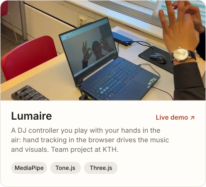
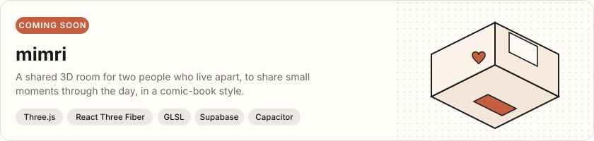
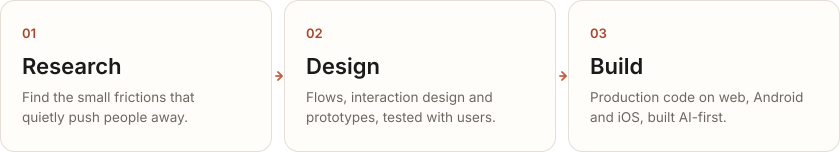
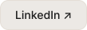

  
  
  
  

I design digital products and then build them myself, from the user research to the production code. 
MSc in Human-Computer Interaction at KTH, with a thesis at BMW Group on a generative in-car UI.

<b>Why I care about the small things</b>

 

I started out believing a beautiful design was everything. Working at Phyllo, a B2B startup in India, changed that: I kept getting pulled into the small blockers that made developers and users drop off early. What matters most is the part people don't see, a flow built on real research that works and is useful first. Making it beautiful comes after.

I took that into 20+ products for 14 freelance clients, and then into my MSc at KTH, where I worked on multi-sensory XR and generative UI. AI changed how I work: I can now build what I design, end to end.

<picture>
  <source media="(prefers-color-scheme: dark)" srcset="assets/title-work-dark.svg">
  
</picture>

  
  

<picture>
  <source media="(prefers-color-scheme: dark)" srcset="assets/title-process-dark.svg">
  
</picture>

  
  
  

